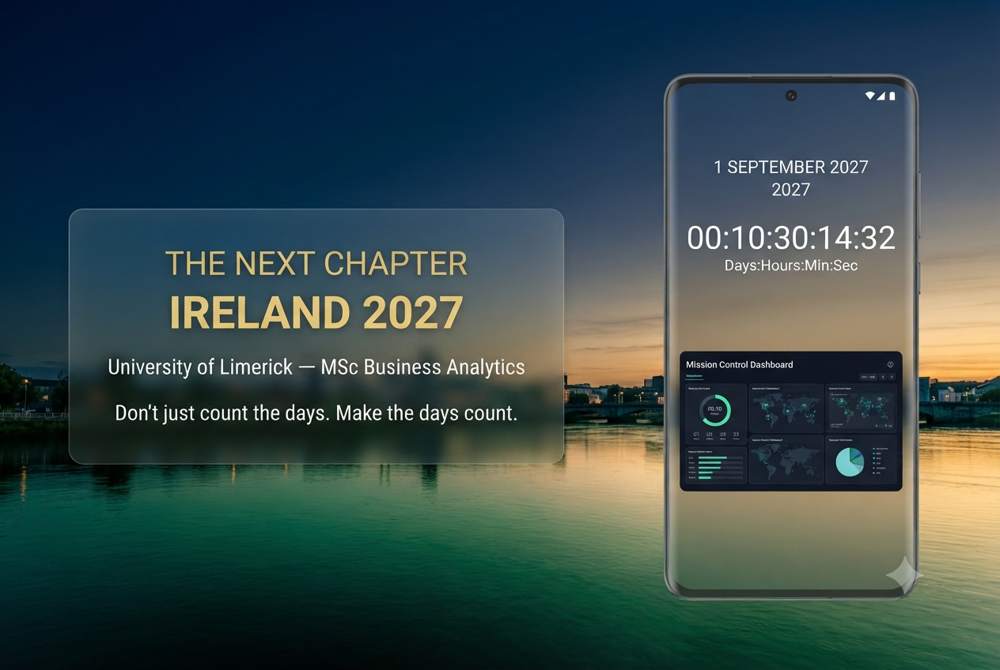

# The Next Chapter — Ireland 2027

> **A countdown becomes a cockpit.**  
> The Next Chapter turns a long-range Ireland 2027 goal into a visual daily practice: a River Shannon-inspired countdown, a plan you can reshape, and a lock screen that carries the next chapter with you.

<div align="center">
  
</div>

<p align="center"><em>One destination, two views: the plan at your desk and the reminder in your pocket.</em></p>

## The idea

Long deadlines are easy to lose inside a calendar. This project makes the destination visible, then brings the next useful action into focus. The interface is built around a personal Ireland 2027 study journey, with a calm Limerick-and-Shannon visual language rather than a generic task dashboard.

<div align="center">
  
</div>

## What you can do

- Watch a live countdown to an editable target date, with timezone controls.
- Shape the route with editable academic, language, funding, visa, and relocation milestones.
- Keep a short daily focus list beside the longer timeline.
- Switch among Emerald Sunset, Midnight Ireland, and Golden Horizon.
- Export a custom phone lock-screen wallpaper.
- Download calendar reminders as a standard `.ics` file.
- Keep edits in this browser; no account, backend, or paid service is required.
- Use the responsive layout and reduced-motion setting across devices.

## Run it

Requires Node.js 20 or newer.

```bash
npm install
npm run dev
```

Build and preview:

```bash
npm run build
npm run preview
```

## Design decisions

- The countdown is the emotional anchor; milestones and daily actions turn it into something actionable.
- The River Shannon-inspired scenery and restrained emerald, midnight, and warm-horizon palettes give the journey a recognizable place and mood.
- Wallpaper export makes the project useful beyond the browser window.
- Calendar export gives reminders a portable format without asking for calendar-account access.
- Browser-local storage keeps a personal planner simple and account-free.

## Data and privacy

This is a personal planning project. Changes stay in the current browser’s local storage. Avoid entering sensitive financial, identity, or immigration-document details. The bundled calendar file contains suggested reminders; verify dates and requirements with official sources before relying on them.

The countdown and milestones are planning aids, not university, immigration, financial, or legal advice. Dates can be changed in Settings.

## Project files

- `src/App.tsx` — dashboard, planner, wallpaper studio, and calendar export.
- `public/assets/ireland-lockscreen.jpg` — portrait wallpaper visual.
- `public/assets/ireland-mission-control.png` — supplied mission-control concept image.
- `public/assets/ireland-2027-milestones.ics` — calendar milestone export.

## License

MIT. See [LICENSE](LICENSE).
